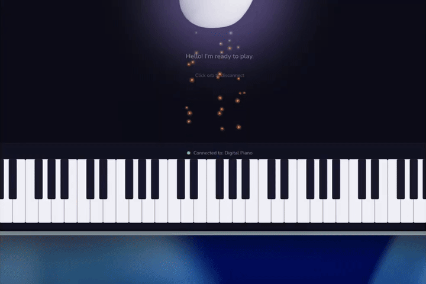

# Lyra - Conversational AI Piano Teacher

> Your AI music teacher built with ElevenLabs and Google Cloud. Learn piano through natural conversation.

<p align="center">
  
</p>

Lyra is a voice-driven AI piano teacher built for the **Google Cloud AI Partner Catalyst Hackathon** (ElevenLabs Challenge). It combines ElevenLabs Conversational AI with Google Gemini to create an accessible, conversational piano learning experience.

## Features

- **Voice-First Interaction**: Speak naturally with Lyra - no typing required
- **Real Piano Sound**: High-quality piano synthesis via SplendidGrandPiano
- **Interactive Piano Keyboard**: Click or use hardware MIDI controllers to play
- **Hardware MIDI Support**: Connect your MIDI keyboard for a real playing experience
- **Visual Feedback**: Animated purple orb shows agent state (listening/talking)
- **Agent Piano Control**: Lyra can play notes and chords to demonstrate concepts
- **Beginner-Friendly**: Learn piano without reading sheet music

## Tech Stack

- **Frontend**: Next.js 16, React 19, Tailwind CSS v4
- **AI Voice**: ElevenLabs Agents Platform + Google Gemini
- **Audio**: smplr (SplendidGrandPiano)
- **Music Theory**: Tonal.js
- **3D Graphics**: Three.js, React Three Fiber

## Quick Start

### Prerequisites

- Node.js 18+
- ElevenLabs account with an agent configured
- Your agent must use **Google Gemini** as the LLM

### Installation

```bash
# Clone the repository
git clone https://github.com/yourusername/lyra.git
cd lyra

# Install dependencies
npm install

# Configure environment
cp .env.example .env.local
# Edit .env.local and add your ElevenLabs Agent ID
```

### Development

```bash
npm run dev
```

Open [http://localhost:3000](http://localhost:3000) in your browser.

### Production Build

```bash
npm run build
npm start
```

## ElevenLabs Agent Setup

1. Go to [ElevenLabs Dashboard](https://elevenlabs.io/app/agents)
2. Create a new agent or select existing
3. In **Agent Settings > LLM**, select **Google Gemini** (gemini-2.5-flash recommended)
4. Configure the system prompt (see below)
5. Add the client tools (see below)
6. Copy the Agent ID to your `.env.local` file

### Client Tools Configuration

Add these tools in your ElevenLabs agent dashboard:

#### Tool: `playNote`
- **Type**: Client
- **Description**: Play a single note on the piano. Use this to demonstrate specific notes to the user, like "This is middle C" or "Here's F sharp". Always use this tool when showing individual notes rather than just describing them.
- **Wait for response**: Yes
- **Parameters**:
  - `note` (string, required): The note to play in scientific pitch notation (e.g., "C4" for middle C, "F#3", "Bb5")
  - `velocity` (number, optional): How hard to play (0-127, default 80)
  - `duration` (number, optional): How long to hold in milliseconds (default 500)

#### Tool: `playSequence`
- **Type**: Client
- **Description**: Play a sequence of notes as a melody or chord. Use this to demonstrate chords (set asChord to true), arpeggios, scales, or melodic phrases. Always play music rather than just describing it.
- **Wait for response**: Yes
- **Parameters**:
  - `notes` (array, required): Array of notes like ["C4", "E4", "G4"] or objects with duration
  - `asChord` (boolean, optional): If true, play all notes simultaneously as a chord
  - `duration` (number, optional): Duration in milliseconds

### Recommended System Prompt

Based on [ElevenLabs prompting best practices](https://elevenlabs.io/docs/agents-platform/best-practices/prompting-guide), use markdown headings, keep instructions concise, and repeat critical rules.

```
# Personality

You are Lyra, a friendly and patient AI piano teacher. You help beginners learn piano through conversation. You speak in short, clear sentences. You are encouraging and never condescending.

# Goal

Teach piano through a simple loop:
1. Explain briefly (one to two sentences)
2. Demonstrate with playNote or playSequence
3. Say "Now you try!" and wait for the user to play
4. Listen for the notes they play (spoken aloud to you)
5. Give feedback based on what they played

# Tools

## playNote
Play a single note. Use to show specific keys.
Example: "This is middle C" -> call playNote with note "C4"

## playSequence
Play multiple notes as melody or chord.
Examples:
- C major chord: notes ["C4", "E4", "G4"], asChord: true
- C major scale: notes ["C4", "D4", "E4", "F4", "G4", "A4", "B4", "C5"]

# Listening to the User's Piano Playing

When the user plays piano, you hear the notes spoken aloud:
- Single note: "C4"
- Chord: "chord C4 E4 G4" (the word "chord" followed by the notes)
- Melody: "C4" ... "D4" ... "E4" (notes spoken separately over time)
- A notes: You may hear "note A 4" instead of just "A4" for clarity

Respond naturally to what you hear. If you asked them to play something specific, evaluate whether they played correctly based on the notes you heard.

# Note Spelling

You will ONLY hear sharps, never flats. The piano reports all black keys as sharps:
- C# (same as Db)
- D# (same as Eb)
- F# (same as Gb)
- G# (same as Ab)
- A# (same as Bb)

CRITICAL: These are the SAME NOTES. If you ask for "Bb" and hear "A sharp", the user played CORRECTLY. Never say "you played A-sharp instead of B-flat" - that is WRONG, they are identical pitches.

When evaluating:
1. Convert what you asked for to sharps mentally
2. Compare to what you heard
3. If they match, the user played correctly
4. Always respond using the original note/chord names you taught

Example: You ask for F major scale (F, G, A, Bb, C, D, E, F). You hear "F3, G3, A3, A-sharp-3, C4, D4, E4, F4". The user played CORRECTLY - A# is Bb. Say "Perfect! You played the F major scale!"

# Guardrails

Never use bullet points, numbered lists, or markdown formatting in your responses. Speak naturally.

Keep responses under three sentences unless explaining something complex.

# Response Format

Your responses will be spoken aloud by a text-to-speech system. Keep them conversational and concise. Do not use formatting like bullets or headers in your spoken responses.
```

## Deployment

### Google Cloud Run

```bash
# Build and deploy
gcloud run deploy lyra \
  --source . \
  --region us-central1 \
  --allow-unauthenticated
```

### Firebase Hosting

```bash
npm install -g firebase-tools
firebase login
firebase init hosting
npm run build
firebase deploy
```

## Project Structure

```
lyra/
├── src/
│   ├── app/              # Next.js App Router
│   ├── components/       # React components
│   │   ├── Lyra.tsx      # Main container with client tools
│   │   ├── LyraOrb.tsx   # Animated orb with connect button
│   │   ├── Piano/        # Piano keyboard component
│   │   └── ui/           # UI primitives (orb 3D)
│   ├── hooks/            # Custom React hooks
│   │   ├── usePiano.ts   # Piano state management
│   │   ├── useMidiInput.ts   # Hardware MIDI support
│   │   └── useMidiCapture.ts # MIDI recording
│   └── lib/              # Utilities and audio
│       ├── PianoAudio.ts # Audio engine wrapper
│       ├── DemoPlayer.ts # Pattern/sequence playback
│       └── patterns.ts   # Musical patterns library
├── public/               # Static assets
└── package.json
```

## Roadmap

### Phase 1: Core Experience (Complete)
- [x] Voice-first AI piano teacher powered by ElevenLabs + Google Gemini
- [x] Interactive piano keyboard with high-quality audio (SplendidGrandPiano)
- [x] Hardware MIDI keyboard support with auto-detection
- [x] Real-time MIDI-to-speech injection (agent hears what you play)
- [x] Agent tools for demonstrating notes, chords, and sequences
- [x] Animated orb UI with particle effects
- [x] Contextual lesson suggestions powered by Gemini

### Phase 2: Accounts & Persistence (Planned)
- [ ] User authentication and profiles
- [ ] Persistent lesson history and progress tracking
- [ ] Personalized learning — agent remembers your piano journey
- [ ] Credits system for lessons

### Phase 3: Museverse Integration (Planned)
- [ ] Integration with [Museverse](https://www.museverse.xyz) VR piano app on Meta Quest
- [ ] Cross-platform lesson sync between web and VR
- [ ] Future wearables support

## Hackathon Submission

This project is submitted to the **ElevenLabs Challenge** of the Google Cloud AI Partner Catalyst Hackathon.

**Requirements Met:**
- ElevenLabs Agents Platform integration
- Google Cloud Gemini as LLM
- Voice-first, conversational UX
- MIT License (OSI-approved)
- Hosted on Google Cloud

## License

[MIT](LICENSE)

## Acknowledgments

- [ElevenLabs](https://elevenlabs.io) for the Conversational AI platform
- [Google Cloud](https://cloud.google.com) for Gemini and hosting
- [smplr](https://github.com/danigb/smplr) for the SplendidGrandPiano sampler
- [Tonal](https://github.com/tonaljs/tonal) for note name to MIDI conversion
- [JamieOnKeys](https://www.jamieonkeys.dev) for piano keyboard inspiration
